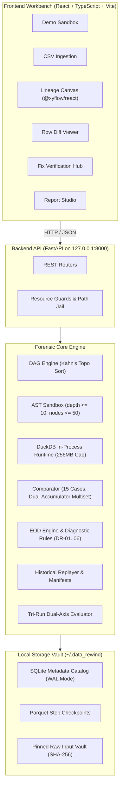

# Data Rewind

**Understand the past. Verify the present.**

Data Rewind is a local-first, zero-operating-cost data engineering workbench designed to investigate data processing pipelines that produce changed, incorrect, or mathematically drifted outputs over time. It provides a deterministic, evidence-based investigation lifecycle:

$$\text{Run} \longrightarrow \text{Detect} \longrightarrow \text{Compare} \longrightarrow \text{Trace} \longrightarrow \text{Assess Impact} \longrightarrow \text{Reproduce} \longrightarrow \text{Fix} \longrightarrow \text{Verify} \longrightarrow \text{Report}$$

Data Rewind is built as an offline forensic engineering tool—**not a generic monitoring dashboard, not an LLM wrapper, and not a chatbot**.

---

## The Problem: Silent Pipeline Regressions

In enterprise data engineering, pipelines frequently finish with an exit code of `0` while silently producing corrupted, drifted, or incomplete datasets:
- **Upstream Source Mutations:** A third-party SaaS vendor or external upstream team alters column semantics, introduces extra rows, or changes data representations without notice.
- **Formula & Expression Drift:** An engineer updates an arithmetic formula, fee calculation, or normalization factor (e.g., changing a fee multiplier from `0.10` to `0.20`), causing subtle numeric discrepancies across millions of rows.
- **Join Dropouts & Fanouts:** A mutated join predicate or missing foreign key silently drops 75% of incoming transactions or accidentally creates cartesian row explosions.
- **Null Sentinel Coercion:** An ingestion type conversion coercing non-standard sentinels (e.g., `""`, `"N/A"`, `"-999"`) silently converts valid measurements into `NULL` values.

Traditional data profilers can tell you that a table changed, but they cannot tell you **which pipeline step caused the divergence**, **what downstream tables are contaminated**, **whether the run is bit-for-bit reproducible**, or **whether a candidate code fix genuinely restores baseline parity without introducing collateral regressions**.

Data Rewind was engineered to solve this entire forensic lifecycle locally on developer hardware with zero recurring operating cost.

---

## What Makes Data Rewind Different?

| Dimension | Generic Dashboard / Profiler | Data Rewind Forensic Workbench |
| :--- | :--- | :--- |
| **Execution Awareness** | Compares static tables at rest; blind to pipeline code and execution order. | Graph-aware: executes DAGs in DuckDB, materializing intermediate step checkpoints. |
| **Row Alignment & Diffing** | Naive diffs or full table scans that choke on row reordering. | 15 operational comparison cases; dual-accumulator order-invariant multiset fingerprinting. |
| **Root-Cause Isolation** | Manual query writing across dozens of intermediate tables. | Automated **Earliest Observable Divergence (EOD)** localization pinpointing the exact faulted step. |
| **Blast Radius Analysis** | Guesswork about downstream impacts. | Directed graph traversal computing affected step counts, tainted terminal datasets, and contaminated row volume. |
| **Fix Verification** | Re-run and visually eyeball final outputs. | **Tri-Run Fix Verification Matrix ($R_0, R_1, R_2$)**: simultaneously evaluates fault remediation and baseline equivalence across 8 canonical verdicts. |
| **Operating Cost & Privacy** | Cloud SaaS subscriptions, cloud warehouse query costs, external data egress. | **Strict ₹0 budget**: 100% offline, local-first execution on loopback `127.0.0.1`, zero telemetry, zero external APIs. |

---

## Key Capabilities

1. **Deterministic Demonstration Regressions:** Pre-loaded, deterministic investigation scenarios (`SCN-01` to `SCN-04`) demonstrating upstream data drift, formula mutations, unmatched join drops, and null sentinel surges.
2. **Vectorized In-Process DuckDB Execution:** Executes multi-step DAG transformations (`FILTER_ROWS`, `DERIVE_COLUMN`, `JOIN_DATASETS`, `AGGREGATE_GROUP_BY`, `DEDUPLICATE_ROWS`, `CAST_COLUMNS`, `SORT_ROWS`) with bounded memory and intermediate checkpoint preservation.
3. **Forensic Tabular Comparator:** Evaluates 15 comparison cases across keyed, composite-keyed, and keyless multiset datasets using 128-bit additive dual-accumulator hashing ($O(N)$ time, $O(1)$ memory).
4. **Automated Diagnostic Rules (DR-01 to DR-06):** Rule engine separating mathematically verified facts (*Proven Observations*) from *Causal Hypotheses* without arbitrary confidence percentages.
5. **Interactive DAG & Lineage Canvas:** Interactive React Flow canvas (`@xyflow/react`) featuring animated taint paths, amber EOD beacon nodes, and a keyboard-navigable accessible table fallback.
6. **Side-by-Side Row Delta Inspection:** Pinned primary keys, highlighted cell drift, and granular status filtering (`ALL`, `MODIFIED`, `ADDED`, `REMOVED`, `IDENTICAL`).
7. **Bit-for-Bit Historical Replayer:** Validates determinism against pinned SHA-256 manifests, classifying outcomes into 5 canonical categories (`REPRODUCIBLE`, `PARTIALLY_REPRODUCIBLE`, `BLOCKED_MISSING_ARTIFACTS`, `DIVERGENT`, `FAILED_VERIFICATION`).
8. **Tri-Run Fix Verification Hub:** Dual-axis verification matrix ($R_0$ Baseline vs $R_1$ Faulted vs $R_2$ Candidate) evaluating 8 formal verdicts including `VERIFIED_CLEAN`, `INTENTIONAL_UPDATE`, `PARTIAL_RESTORATION`, and `REGRESSION_UNRESOLVED`.
9. **Forensic Report Studio:** Dossier export in JSON, Markdown, and CSV featuring Type-Aware Formula Injection Protection.
10. **Resource-Bounded Ingestion:** Strict RFC 4180 parsing, 50 MB upload gate, 500k row limit, 100 column limit, 4,096 character cell ceiling, and 64 KB line ceiling.

---

## Demonstration Scenarios

Data Rewind ships with four built-in, deterministic scenarios designed for immediate evaluation:

```
+----------+----------------------------------+-----------------------+--------------------------------------+
| Scenario | Title                            | Injected Defect       | Expected Root-Cause Rule & EOD Step  |
+----------+----------------------------------+-----------------------+--------------------------------------+
| SCN-01   | Upstream Vendor Input Data Drift | Mutated records &     | DR-01_UPSTREAM_INPUT_DATA_DRIFT      |
|          |                                  | extra row at boundary | EOD: ingest_orders                   |
+----------+----------------------------------+-----------------------+--------------------------------------+
| SCN-02   | Arithmetic Formula Drift         | Fee calculation       | DR-02_ARITHMETIC_EXPRESSION_MUTATION |
|          |                                  | changed 0.10 -> 0.20  | EOD: compute_fee                     |
+----------+----------------------------------+-----------------------+--------------------------------------+
| SCN-03   | Unmatched Join Drop              | Predicate mutation    | DR-03_UNMATCHED_JOIN_DROP            |
|          |                                  | drops 75% of rows     | EOD: join_orders_customers           |
+----------+----------------------------------+-----------------------+--------------------------------------+
| SCN-04   | Null Sentinel Surge              | Sentinel coercion     | DR-05_NULL_SENTINEL_SURGE            |
|          |                                  | produces NULL scores  | EOD: clean_data                      |
+----------+----------------------------------+-----------------------+--------------------------------------+
```

- **`SCN-01` (Upstream Vendor Input Data Drift):** Evaluates how the platform handles external data corruption where the pipeline logic is unchanged but source payloads drift. Traces taint across 3 downstream steps and 1 terminal dataset.
- **`SCN-02` (Formula Drift):** Demonstrates detection of silent numeric drift where schema and row counts match 100%, but derived float values diverge.
- **`SCN-03` (Unmatched Join Drop):** Evaluates a catastrophic join drop caused by an overly restrictive join condition (`t2.name = 'Alice'`), isolating the exact step where row counts drop from 4 to 1.
- **`SCN-04` (Null Sentinel Surge):** Demonstrates coercion failure where valid metric values become `NULL`, triggering diagnostic rule DR-05 and highlighting cell-level null transitions.

---

## Architecture Overview



---

## Technology Stack

| Layer | Technology | Version | Architectural Responsibility |
| :--- | :--- | :--- | :--- |
| **Frontend Framework** | React + TypeScript | React 18.3 / TS 5.7 | Single-page application shell, state management, and type safety. |
| **Graph Visualization** | `@xyflow/react` | 12.4.2 | Interactive DAG canvas, animated taint propagation edges, EOD node beacons. |
| **UI Styling & Icons** | Tailwind CSS / Lucide React | Tailwind 3.4 / Lucide 0.475 | Dark-mode terminal design aesthetic and forensic status icon sets. |
| **Frontend Testing** | Vitest / Testing Library | Vitest 3.2.7 | Unit and component DOM testing with zero browser overhead. |
| **Browser E2E Testing** | Playwright (Chromium) | 1.64.1 | Headless browser automation executing real multi-step user journeys. |
| **Backend API** | FastAPI / Uvicorn | FastAPI 0.115 / Uvicorn 0.34 | High-performance asynchronous API bound strictly to loopback `127.0.0.1`. |
| **Tabular SQL Engine** | DuckDB (In-Process) | 2.0.0 | Vectorized in-memory SQL execution, zero database server overhead, 256 MiB memory ceiling. |
| **Expression Sandboxing**| Python `ast` Visitor | Standard Library | Anti-RCE expression parser rejecting calls, imports, and excessive complexity. |
| **Metadata Persistence** | SQLite 3 (WAL Mode) | Standard Library | Local catalog storage for investigations, manifests, and verification dossiers. |
| **Validation & Schema** | Pydantic v2 | 2.14.1 | Strict domain model validation, immutable frozen schemas, and error hierarchies. |
| **Process Telemetry** | psutil | 7.2.2 | High-resolution RSS memory sampling (10ms) and disk admission enforcement. |
| **Linter & Formatter** | Ruff | 0.9.9 | Lightning-fast Python linting and deterministic code formatting. |
| **Type Checker** | Mypy (Strict Mode) | 1.15.0 | Zero-warning static type checking across all backend modules. |

---

## Installation & Local Setup

### System Prerequisites
- **Operating System:** Windows 10/11, macOS 12+, or Ubuntu 22.04+ LTS.
- **Python:** Python 3.11.x or 3.12.x (Verified on Python 3.12.0 x86_64).
- **Node.js:** Node.js 20.x or 24.x LTS (Verified on Node.js v24.21.0).
- **Package Managers:** `pip` and `npm` (Verified on npm 11.19.0).

---

### Method 1: One-Click Launch (Recommended)

#### Windows
Double-click `run.bat` or run from Command Prompt / PowerShell:
```cmd
run.bat
```

#### Linux / macOS
```bash
chmod +x run.sh
./run.sh
```

The launcher automatically:
1. Validates that Python 3.11+ and Node.js 20+ are in `PATH`.
2. Activates the Python virtual environment (`.venv`).
3. Installs frontend dependencies if `node_modules` is absent.
4. Starts the FastAPI backend daemon bound strictly to `127.0.0.1:8000`.
5. Starts the Vite frontend server on `http://localhost:5173`.
6. Opens the Data Rewind Workbench in your default web browser.

---

### Method 2: Manual Developer Setup

#### 1. Backend Setup
```powershell
# Create and activate virtual environment
python -m venv .venv
.\.venv\Scripts\Activate.ps1   # On Linux/macOS: source .venv/bin/activate

# Install dependencies and editable package
pip install -e ".[dev]"

# Launch backend API server
python -m data_rewind.cli serve --port 8000
```

#### 2. Frontend Setup
In a second terminal:
```powershell
cd frontend
npm.cmd install              # On Linux/macOS: npm install
npm.cmd run dev              # On Linux/macOS: npm run dev
```

#### 3. Verification Addresses
- **Frontend Workbench:** `http://localhost:5173`
- **Interactive API Documentation:** `http://127.0.0.1:8000/api/docs`
- **Backend Healthcheck:** `http://127.0.0.1:8000/api/v1/health`

#### 4. Stopping the Application
- Press `Ctrl + C` in each terminal. On Windows, closing the launcher console cleanly terminates background subprocesses.

---

## 5-Minute Evaluation Walkthrough

Follow this step-by-step path to experience the core investigation loop:

1. **Launch the Workbench:** Open `http://localhost:5173`. Ensure the header displays `HEALTH: OK (0.1.0)`.
2. **Select Scenario SCN-01:** Navigate to the **Demo Sandbox** tab. Notice the pre-loaded scenarios. Select **SCN-01: Upstream Vendor Input Data Drift**.
3. **Execute Full Investigation:** Click the green **Run Investigation** button. The engine runs the baseline ($R_0$) and faulted ($R_1$) pipelines, computes multiset hashes, localizes the Earliest Observable Divergence, and redirects you to the **Investigation & Lineage** tab.
4. **Inspect the Lineage Graph:** 
   - Note the amber **EOD Beacon** on node `ingest_orders`.
   - Observe the animated red taint edges flowing downstream into `filter_completed` and `aggregate_revenue`.
   - Inspect the **Blast Radius Metrics**: `3 affected steps`, `1 terminal dataset`, `5 contaminated rows`.
5. **Inspect Granular Row Deltas:**
   - Under the graph, select step `ingest_orders` in the step selector.
   - In the **Diff Table**, toggle the status filter to `MODIFIED`.
   - Inspect row `order_id = 1`: observe the `amount` cell drift from `100.00` to `120.00`.
   - Toggle to `ADDED`: observe the uncontracted extra row `order_id = 5` injected by the upstream vendor.
6. **Execute Tri-Run Fix Verification:**
   - Return to the **Demo Sandbox** tab.
   - Under **Tri-Run Fix Verification**, ensure remediation mode is set to `Clean Fix`.
   - Click **Verify Fix Candidate**.
   - The workbench redirects to the **Fix Verification Hub**, rendering a green **VERIFIED_CLEAN** verdict confirming that candidate run $R_2$ successfully remediated the fault while maintaining 100% equivalence to baseline $R_0$.
7. **Export the Forensic Dossier:**
   - Click **Export Signed Dossier** to enter the **Report Studio**.
   - Select **Spreadsheet-Safe CSV** or **Markdown**.
   - Click **Download Dossier** to obtain a signed, audit-ready artifact with Type-Aware Formula Injection Protection.

---

## Quality Gates & Verification Evidence

All quality gates are enforced locally and verified against Git commit `6dddbf5`:

```powershell
# 1. Backend Pytest & Branch Coverage (>= 90% threshold)
pytest -v --cov=data_rewind --cov-fail-under=90
# Result: 251 passed in 25.41s | 90.66% combined statement + branch coverage

# 2. Ruff Linter & Formatting Checks
ruff check src tests
ruff format --check src tests
# Result: 97 files checked | 0 issues found | 100% clean formatting

# 3. Mypy Strict Static Type Checking
mypy src
# Result: Success: no issues found in 74 source files

# 4. Core Foundations Smoke Test
python -m data_rewind.smoke_test
# Result: 8/8 OK - ALL CORE ENGINE FOUNDATION SMOKE TESTS PASSED [100% OK]

# 5. Resource Guards & Diagnostics Check
python -m data_rewind.cli diagnostics
# Result: PASS (Available memory > 100 MB free, 512 MiB RSS ceiling enforced)

# 6. Frontend Unit Tests (Vitest)
npm.cmd --prefix frontend test
# Result: 17 passed across 6 test files in 65.73s

# 7. Frontend Production Type-Check & Bundle Build
npm.cmd --prefix frontend run build
# Result: 1,764 modules transformed | built in 9.66s | 0 type errors

# 8. Playwright Browser E2E Integration Suite (15 User Journeys)
npm.cmd --prefix frontend run test:e2e
# Result: 15 passed across 7 test specs in 58.90s

# 9. End-to-End Performance & Memory Benchmark Suite
python -m data_rewind.cli benchmark
# Result: ALL BUDGETS PASSED (Peak RSS 301.9 MiB, Delta RSS 103.9 MiB, Latency 605.1 ms)
```

> **Note on Remote CI:** Remote GitHub Actions workflow status is **NOT VERIFIED** because no remote Git origin is configured in this local repository. The CI workflow definition (`.github/workflows/ci.yml`) is provided and mirrors the local verification commands listed above.

---

## Performance & Resource Boundaries

The platform enforces strict resource boundaries to guarantee stability on single developer workstations:

| Boundary / Guardrail | Configured Limit | Measured Benchmark Performance | Safety Margin | Specification Reference |
| :--- | :--- | :--- | :--- | :--- |
| **Max Process Peak RSS** | $< 512.0$ MiB | **301.9 MiB** (during 500k row keyed diff) | **-210.1 MiB (-41.0%)** | SPEC-MOD-09 §2 |
| **500k Keyed Diff Latency** | $< 1,500.0$ ms | **605.1 ms** (vectorized DuckDB outer join) | **-894.9 ms (-59.7%)** | SPEC-MOD-09 §2 |
| **500k Keyed Diff Delta RSS**| $< 120.0$ MiB | **103.9 MiB** | **-16.1 MiB (-13.4%)** | SPEC-MOD-09 §2 |
| **Partition Completeness** | 100% Valid | **100% Valid** (0 unpartitioned rows) | Mathematical invariant | SPEC-MOD-04 §1 |
| **Max CSV File Upload** | 50 MB | Enforced via chunked streaming counter | Rejects with `413` | SPEC-MOD-01 §2 |
| **Max Ingestion Rows** | 500,000 | Enforced during RFC 4180 parsing | Rejects with `413` | SPEC-MOD-09 §1 |
| **Max Ingestion Columns** | 100 | Enforced during header inspection | Rejects with `400` | SPEC-MOD-09 §1 |
| **Max Cell String Length** | 4,096 chars | Enforced on every CSV token | Rejects with `400` | SPEC-MOD-06 §2 |
| **Max Line Byte Length** | 64 KB | Buffer limit on CSV line reader | Rejects with `400` | SPEC-MOD-06 §2 |
| **AST Sandbox Expression** | Depth $\le 10$, Nodes $\le 50$ | Validated prior to execution | Rejects with `400` | SPEC-MOD-06 §3 |

---

## Security & Correctness Safeguards

- **Sandboxed Expression Interpreter:** Pipeline derivation and filter expressions execute via an AST visitor allowing only basic arithmetic, comparisons, and pure boolean operations. Calls to `eval()`, `exec()`, `__import__()`, attribute lookups, and builtins are strictly prohibited.
- **SQL Parameter Whitelisting:** Join types are restricted to `{'INNER', 'LEFT', 'RIGHT', 'FULL', 'CROSS', 'SEMI', 'ANTI'}`. Semicolons (`;`) and comment tokens (`--`, `/*`) are blocked in join predicates. Aggregate expressions are checked against regex allowlists.
- **Path Jail Containment:** `validate_safe_path` confines all artifact reading, writing, and workspace purge operations to `~/.data_rewind`, preventing directory traversal (`../`) attacks.
- **Type-Aware Formula Injection Shielding:** Report exports protect downstream Excel/Calc users by prepending `'` to text cells beginning with `=`, `+`, `-`, `@`, `\t`, or `\r`, while preserving raw formatting for authentic numeric values.
- **Loopback Isolation:** The API server binds exclusively to `127.0.0.1`. Cross-Origin Resource Sharing (CORS) permits requests solely from `localhost` and `127.0.0.1`.

---

## Project Limitations

In adherence to honest engineering standards, the following architectural boundaries of v0.1.0 are documented:

1. **Input Format Scope (Decision D-03):** v0.1.0 natively ingests tabular CSV files conforming to RFC 4180. Direct ingestion of Parquet, Avro, or JSON Lines without conversion is planned for future milestones.
2. **Supported Transformation Vocabulary:** The built-in execution engine supports 7 core transformation primitives (`FILTER_ROWS`, `DERIVE_COLUMN`, `JOIN_DATASETS`, `AGGREGATE_GROUP_BY`, `DEDUPLICATE_ROWS`, `CAST_COLUMNS`, `SORT_ROWS`). Complex window functions or user-defined C extensions are not supported.
3. **Single-Node Execution:** The execution runtime utilizes an in-process DuckDB engine tuned for single-machine multicore execution up to 500,000 rows. It is not a distributed computing cluster replacement for Apache Spark or Trino.
4. **Historical Replay Prerequisite:** Replay verification requires that pinned input artifacts remain present in workspace storage. If an artifact was manually deleted or purged, the replayer classifies the run as `BLOCKED_MISSING_ARTIFACTS`.
5. **Pure Branch Coverage:** Combined statement + branch coverage is **90.66%**, while pure branch coverage alone is **81.69%** due to deeply defensive CLI subprocess exception branches.

---

## Project Status

- **Current Version:** `0.1.0` (Production Release Candidate 1)
- **Milestones Completed:** Milestones 1.0 through 6.0 fully implemented, hardened, and verified.
- **Audit Reports:** Detailed audit and verification reports are documented in [`docs/reports/`](file:///e:/MHT CET REGISTRATION/BE/Task/DataRewind/docs/reports/).
- **Repository State:** Verified clean working tree on branch `main` at commit `6dddbf5`.

---

## License

Data Rewind is declared under the **MIT License** in [`pyproject.toml`](file:///e:/MHT CET REGISTRATION/BE/Task/DataRewind/pyproject.toml). A formal standalone `LICENSE` text file should be placed at the repository root prior to public distribution.
