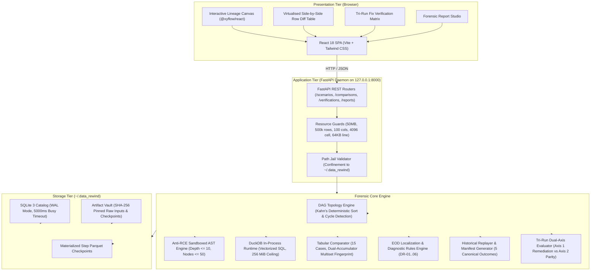
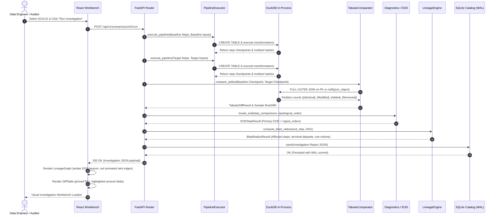
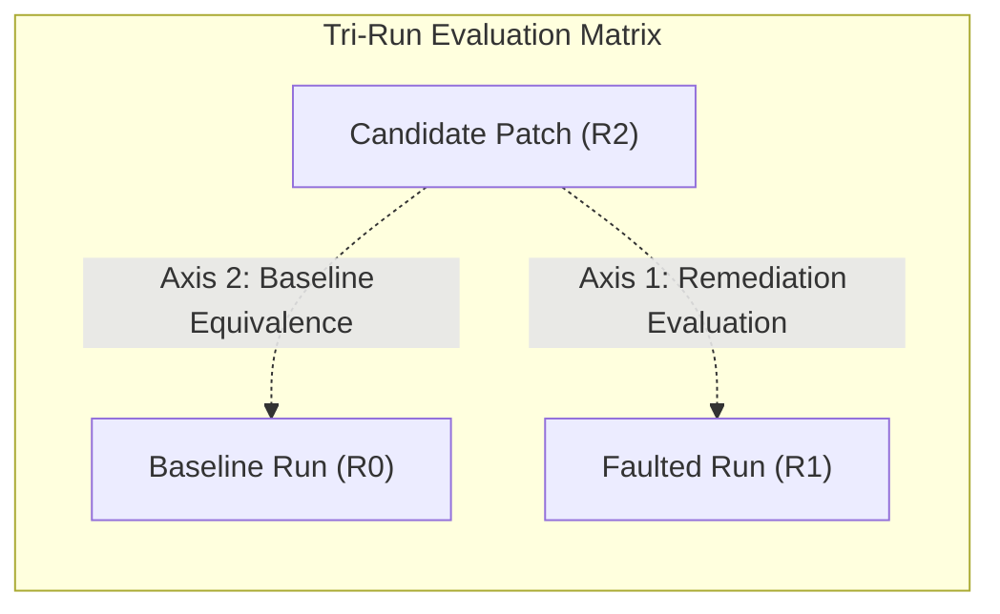

# Data Rewind — System Architecture Specification

**Document Version:** 1.0.0  
**Target Release:** Data Rewind v0.1.0  
**Author:** Data Rewind Engineering Team  
**Tagline:** *Understand the past. Verify the present.*

---

## 1. System Overview

Data Rewind is an offline-first, zero-operating-cost data engineering workbench designed to investigate data processing pipelines that produce changed, incorrect, or mathematically drifted outputs over time. It provides an evidence-based forensic investigation lifecycle:

$$\text{Run} \longrightarrow \text{Detect} \longrightarrow \text{Compare} \longrightarrow \text{Trace} \longrightarrow \text{Assess Impact} \longrightarrow \text{Reproduce} \longrightarrow \text{Fix} \longrightarrow \text{Verify} \longrightarrow \text{Report}$$

### Core Architecture Tenets
1. **Local-First & ₹0 Operating Cost:** The entire workbench executes on standard developer workstations without cloud subscriptions, external API calls, paid database clusters, or remote data egress.
2. **Deterministic & Evidence-Backed:** All findings are derived from mathematical set operations, cryptographic hashes, and exact row outer joins—never from non-deterministic heuristics, black-box confidence scores, or LLMs.
3. **In-Process Analytical Execution:** Utilizes an embedded, vectorized DuckDB engine with an explicit memory ceiling (`SET max_memory = '256MB'`), providing high-throughput SQL analytics without database server overhead.
4. **Defense-in-Depth Sandboxing:** User-configured transformations execute within a sandboxed Python AST evaluator and strict SQL token allowlists, neutralizing remote code execution (RCE) and SQL injection vulnerabilities.

---

## 2. Component Architecture



### Module Responsibilities

| Subsystem | Package Path | Primary Architectural Responsibility |
| :--- | :--- | :--- |
| **Domain Models & FSM** | `data_rewind.core.domain` | Frozen Pydantic schemas, `RunLifecycle` finite-state machine, and immutable error hierarchies. |
| **DAG Engine** | `data_rewind.core.dag` | Kahn's topological sort with lexicographical tie-breaking; cycle diagnostics and path extraction. |
| **Sandboxed AST Interpreter** | `data_rewind.core.expr` | AST node visitor allowlisting basic arithmetic, comparisons, and boolean logic. Disallows calls, imports, and attributes. |
| **DuckDB Runtime** | `data_rewind.core.db` | Thread-safe connection lifecycle, transaction rollback, and memory ceiling (`256MB`). |
| **Integrity & Storage** | `data_rewind.core.integrity` | Canonical row UTF-8 serialization, single-row SHA-256, additive dual-accumulator multiset hashing, and `ArtifactStorageVault`. |
| **Resource Guards** | `data_rewind.core.config` | Enforces 50 MB file size, 500k rows, 100 columns, 4,096 char cells, 64 KB lines, and disk admission gates. |
| **Tabular Comparator** | `data_rewind.comparator` | Evaluates 15 comparison cases across keyed and multiset tables; samples `ValueDiff` deltas via outer joins. |
| **Diagnostic Rules & EOD** | `data_rewind.diagnostics` | Identifies Earliest Observable Divergence (EOD) and evaluates diagnostic rules (DR-01 to DR-06). |
| **Step Execution Engine** | `data_rewind.execution` | Executes 7 transformation types (`FILTER`, `DERIVE`, `JOIN`, `AGGREGATE`, `DEDUP`, `CAST`, `SORT`) in DuckDB. |
| **Lineage & Taint Engine** | `data_rewind.lineage` | Forward/backward BFS traversal computing downstream blast radius and contaminated terminal datasets. |
| **Historical Replayer** | `data_rewind.replay` | Validates bit-for-bit execution determinism against pinned manifests across 5 canonical outcomes. |
| **Investigation Persistence**| `data_rewind.investigation` | Serializes complete investigation reports into SQLite catalog using WAL journal mode. |
| **Tri-Run Fix Verification** | `data_rewind.verification` | Evaluates candidate patches across Axis 1 (Remediation) and Axis 2 (Baseline Equivalence), yielding 8 canonical verdicts. |
| **Demonstration Scenarios** | `data_rewind.scenarios` | Pre-loaded, deterministic investigation regressions (`SCN-01` to `SCN-04`). |
| **Performance Benchmarks** | `data_rewind.benchmarks` | End-to-end memory and latency benchmarks with `psutil` sampling at 10ms intervals. |
| **REST API Layer** | `data_rewind.api` | FastAPI routers exposing typed endpoints strictly over loopback `127.0.0.1:8000`. |
| **Frontend Workbench** | `frontend/src` | React 18 single-page application with `@xyflow/react` graph canvas and accessible table fallbacks. |

---

## 3. Request and Data Flow

The following sequence diagram traces the complete lifecycle of a forensic pipeline investigation:



---

## 4. Data and Artifact Lifecycle

### Local Storage Structure
All application data is isolated within the user's local profile (`~/.data_rewind` on Linux/macOS, `C:\Users\<User>\.data_rewind` on Windows):

```
~/.data_rewind/
├── raw_inputs/                 # Pinned source payloads named by SHA-256 digest
│   ├── 8f3a9b...csv
│   └── c4e17d...csv
├── checkpoints/                # Materialized intermediate Parquet checkpoints
│   └── <run-uuid>/
│       ├── ingest_orders.parquet
│       ├── filter_completed.parquet
│       └── aggregate_revenue.parquet
├── artifacts/                  # Exported dossiers (Markdown, JSON, Spreadsheet-Safe CSV)
└── metadata.db                 # SQLite 3 catalog (WAL mode, busy_timeout = 5000ms)
    ├── investigations          # Serialized investigation reports
    ├── replay_manifests        # Pinned historical execution manifests
    ├── verifications           # Tri-run fix evaluation records
    └── dossiers                # Signed forensic verification dossiers
```

### Artifact Write Safety
Materialized step checkpoints write to a temporary file (`.tmp`) before calling `fsync()` and performing an atomic rename via `os.replace()`. This ensures that interrupted pipeline runs never leave corrupted or partially written files in storage.

### Workspace Purge & Privacy
Operators can inspect storage consumption and invoke an application-managed purge from the **Workspace** tab. To avoid accidental data loss, the purge operation is strictly jailed to subdirectories within `~/.data_rewind/` and preserves database schema definitions.

---

## 5. Reproducibility Semantics

Historical replay evaluates whether a past execution can be reproduced bit-for-bit from pinned inputs and DAG definitions:

| Canonical Outcome | Mathematical Preconditions | Operational Verdict |
| :--- | :--- | :--- |
| **`REPRODUCIBLE`** | 1. All raw inputs present by SHA-256.<br>2. Pipeline definition matches `pipeline_definition_hash` 100%.<br>3. All step output multiset hashes match historical records 100%. | *"Historical run successfully reproduced with 100% mathematical equivalence."* |
| **`PARTIALLY_REPRODUCIBLE`** | 1. Input hashes match.<br>2. Re-execution completes.<br>3. Outputs match within floating-point tolerance ($\text{atol} \le 10^{-6}, \text{rtol} \le 10^{-5}$) or multiset contents match despite row order drift (Case 6). Also returned when available terminal checkpoints match 100% but intermediate hashes were unrecorded. | *"Historical run partially reproduced: step outputs match within configured tolerances or available checkpoints."* |
| **`BLOCKED_MISSING_ARTIFACTS`**| One or more raw input artifacts referenced in the manifest have been deleted or purged from workspace storage. | *"Replay blocked: Raw input artifact '{id}' is no longer retained in workspace storage."* |
| **`DIVERGENT`** | Inputs and definition match, but re-executed multiset hashes differ materially from historical records. | *"Divergence detected: Engine re-execution produced output hashes differing from historical records starting at step '{step_id}'."* |
| **`FAILED_VERIFICATION`** | Replay execution crashes due to an unhandled exception, AST rejection, syntax failure, or tampered `pipeline_definition_hash`. | *"Replay execution failed during evaluation at step '{step_id}': {error}"* |

---

## 6. Security Boundaries & Guardrails

```
+----------------------------------------------------------------------------------------------------+
|                                    DEFENSE-IN-DEPTH SECURITY GATES                                 |
+--------------------------+-----------------------+-------------------------------------------------+
| Gate                     | Limit / Policy        | Enforcement Mechanism                           |
+--------------------------+-----------------------+-------------------------------------------------+
| Max File Upload Size     | 50 MB                 | Chunked streaming counter rejects with 413.     |
| Max Row Count            | 500,000 rows          | Pre-flight row scan rejects with 413.           |
| Max Column Count         | 100 columns           | CSV header parser rejects with 400.             |
| Max Cell String Length   | 4,096 characters      | Token scanner rejects with 400.                 |
| Max Line Byte Length     | 64 KB                 | Buffer reader limit rejects with 400.           |
| AST Expression Depth     | Depth <= 10           | Recursive AST visitor tracks depth; aborts.     |
| AST Expression Nodes     | Nodes <= 50           | AST node counter aborts on complexity explosion.|
| AST Execution Sandbox    | Zero eval / exec      | Disallows imports, calls, attribute traversal.  |
| SQL Token Allowlisting   | Strict Grammar        | Validates join types, aggregate regex, drops ;. |
| Path Jail Containment    | Confined to workspace | validate_safe_path blocks traversal attacks.    |
| Formula Injection Shield | Safe CSV Export       | Prepends ' to leading =, +, -, @, \t, \r cells. |
| Network Loopback Only    | 127.0.0.1 Binding     | Daemon binds strictly to loopback interface.    |
+--------------------------+-----------------------+-------------------------------------------------+
```

---

## 7. Tri-Run Fix Verification Matrix ($R_0, R_1, R_2$)

When an engineer deploys a candidate fix ($R_2$) to resolve a regression ($R_1$) relative to a historical baseline ($R_0$), Data Rewind simultaneously evaluates both dimensions:



### The 8 Canonical Verdicts
1. **`VERIFIED_CLEAN`:** Fault resolved; 100% mathematical equivalence to baseline restored.
2. **`INTENTIONAL_UPDATE`:** Fault resolved; divergence from baseline is deliberate, contracted logic drift.
3. **`PARTIAL_RESTORATION`:** Primary fault partially resolved; non-material numeric or row-order variances persist.
4. **`REGRESSION_UNRESOLVED`:** Candidate patch failed to remediate the defect; faulted behavior persists.
5. **`NEW_FAULT_INTRODUCED`:** Candidate patch introduced a new, uncontracted failure in previously healthy steps.
6. **`BASELINE_UNAVAILABLE`:** Remediation verified against $R_1$, but historical baseline $R_0$ was not captured.
7. **`FAULT_UNREPRODUCIBLE`:** Faulted run $R_1$ cannot be reproduced; candidate verification is indeterminate.
8. **`INCONCLUSIVE_VERIFICATION`:** Execution failed or required evidence artifacts are missing.

---

## 8. Architectural Trade-offs & Decisions

| Decision ID | Chosen Architecture | Rejected Alternative | Architectural Justification |
| :--- | :--- | :--- | :--- |
| **D-01** | In-Process DuckDB Runtime | Distributed Spark / Trino / Postgres | Zero-cost setup, instant startup (< 50ms), zero network latency, embedded execution on developer laptops. |
| **D-02** | React Flow (`@xyflow/react`) | Static SVG or Server-Rendered Graphs | High-performance interactive DAG canvas with native zoom, pan, animated edge styling, and custom node components. |
| **D-03** | RFC 4180 CSV Ingestion | Multi-Format (Parquet, Avro, Iceberg) | Kept v0.1.0 scoped to universal text interchange format before expanding format matrix in subsequent releases. |
| **D-04** | 4 Deep Pre-loaded Scenarios | Shallow Mock Data | Real multi-step pipelines isolating specific, mathematically verifiable regression types without external dependencies. |
| **D-05** | Desktop Loopback (`127.0.0.1`) | Hosted Multi-Tenant Cloud SaaS | Complete enterprise data privacy (zero egress), zero hosting bills, 100% offline operational independence. |
| **D-06** | Dual-Accumulator Multiset Hash | Cryptographic Row Sorting | $O(N)$ time and $O(1)$ memory dual 128-bit sum accumulator hash invariant to row order without sorting terabytes of data. |
