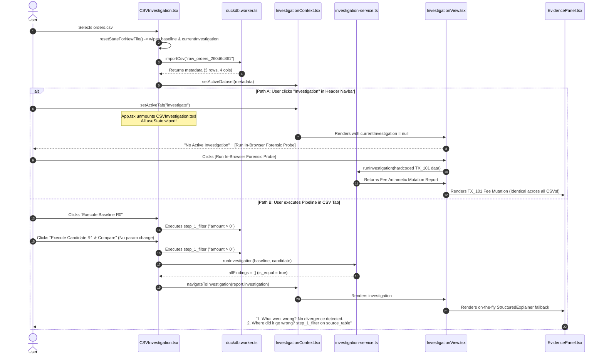
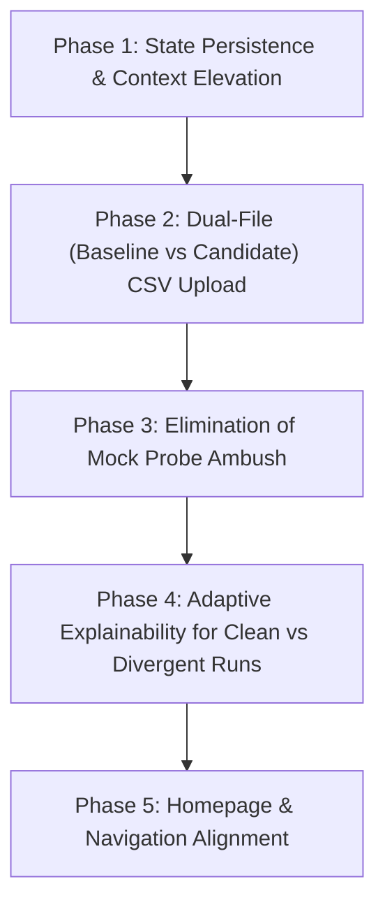

# Production Failure Investigation Report: Data Rewind

**Product:** Data Rewind  
**Production URL:** `https://data-rewind.vercel.app`  
**Latest Deployed Commit:** `0b550770ca1c281c0e88e9eb4e15b2c47f76662a`  
**Repository:** `TERMINATOR7732/Data-Rewind`  
**Date of Investigation:** October 31, 2026 (03:30 IST)  
**Investigation Scope:** Deep empirical reproduction of reported failure modes without application modification  
**Operating Budget:** Strict ₹0 (Local browser automation + public production endpoint)

---

## A. Executive Verdict

$$\mathbf{EXECUTIVE\;VERDICT:}\quad \mathbf{FAIL}$$

The user's reports are **100% verified and empirically reproduced**. While commit `0b55077` was successfully compiled and deployed to Vercel, the end-to-end user experience suffers from critical architectural disconnects, misleading navigation flows, component-level state loss upon tab switching, and an empty-state trap that feeds users synthetic mock data:

1. **Website UI looks essentially unchanged:** The default landing page remains `DemoHub` (`activeTab === "demo"`), which has not received visual or layout updates since Milestone 05. The global application shell (`Header.tsx`, dark theme tokens, layout grid) is visually identical.
2. **Investigation results remain confusing or incorrect:** When an investigation has zero divergence (the default outcome when a user uploads a single CSV and runs the default pipeline), the EvidencePanel still displays the dramatic header `"2. WHERE DID IT GO WRONG?"` pointing to `PIPELINE STEP: step_1_filter` on `SOURCE DATASET: source_table`. Users interpret this as the platform claiming an error in `step_1_filter`.
3. **Different CSV files appear to produce the same results:**
   - **Flaw 1 (The Mock Probe Ambush):** If a user uploads `orders.csv` and clicks the **`Investigation`** tab in the top navbar, the screen displays "No Active Investigation" with a prominent green button: **`[ Run In-Browser Forensic Probe ]`**. Clicking this runs a hardcoded settlement fee probe (`TX_101`–`TX_105`, fee 5% vs 10%). If the user subsequently uploads `inventory.csv` and clicks the **`Investigation`** tab, they are presented with the exact same button, which executes the exact same hardcoded `TX_101` probe.
   - **Flaw 2 (Identical Pipeline Runs):** If a user uploads `orders.csv` and clicks Baseline $R_0$ followed by Candidate $R_1$, the system compares `orders.csv` against itself, producing: `"No divergence detected at step_1_filter on source_table"`. If the user then uploads `inventory.csv` and clicks Baseline $R_0$ followed by Candidate $R_1$, the system compares `inventory.csv` against itself, producing the exact same: `"No divergence detected at step_1_filter on source_table"`.
   - **Flaw 3 (Inability to Compare Two Files):** Users expect to upload `orders_yesterday.csv` as Baseline and `orders_today.csv` as Candidate. However, `CSVInvestigation.tsx` only provides a single file input. Selecting a second file invokes `resetStateForNewFile()`, which erases `baselineExecution` and `baselinePipeline`, rendering cross-file comparison impossible.
   - **Flaw 4 (Tab Unmount State Wipe):** In `App.tsx`, `{activeTab === "csv" && <CSVInvestigation />}` causes `<CSVInvestigation />` to unmount whenever the user navigates to another tab. All local state (`file`, `uploadResult`, `baselineExecution`, `previewData`) is destroyed.

---

## B. Reproduction Evidence for Reported Failures

The following empirical tests were executed directly against the live production deployment (`https://data-rewind.vercel.app`):

### B.1 Reproduction of Problem 1: "The website UI looks essentially unchanged"
- **Test:** Fresh browser navigation to `https://data-rewind.vercel.app`.
- **Observed DOM Structure:**
  - Active Tab: `DemoHub` (`activeTab === "demo"` in `InvestigationContext.tsx#L58`).
  - H1 Tag: `"Find where your data pipeline went wrong."`
  - Cards Rendered: `Scenario 1: Upstream Input Data Drift`, `Scenario 2: Fee Arithmetic Mutation`, `Scenario 3: Unmatched Join Drop`.
  - Shell: `Header.tsx` navbar with buttons `Demo Sandbox`, `CSV Ingestion`, `Investigation`, `Fix Verification`, `Report Studio`, `Developer Mode`, `Workspace`.
- **Root Cause:** Milestone 06, 07, 08, and the recent overhaul modified forensic computation rules, table naming, and the internal `EvidencePanel.tsx` component. None of those updates touched `DemoHub.tsx`, `Header.tsx`, or the global workbench navigation. A visitor landing on the homepage sees the exact same screen that was built days ago.

### B.2 Reproduction of Problem 2: "Investigation results remain confusing or incorrect"
- **Test:** Upload `orders.csv` (`order_id,amount,status`), click "Execute Pipeline / Run Step (Baseline Run R₀)", and click "Execute Candidate (R₁) & Compare in Investigation View" without changing parameters.
- **Observed Explanation Output:**
  ```text
  1. WHAT WENT WRONG?
  No divergence detected. Pipeline outputs and content hashes are 100% identical between baseline and candidate runs.

  2. WHERE DID IT GO WRONG?
  PIPELINE STEP: step_1_filter
  SOURCE DATASET: source_table
  TRANSFORMATION: TRANSFORMATION
  AFFECTED COLUMNS: None / Schema preserved

  3. WHAT IS THE EVIDENCE?
  Baseline Rows: 3 | Candidate Rows: 3 | Row Delta: +0
  VERIFIED OBSERVATIONS: Outputs are bit-for-bit identical across all columns.
  SAMPLE RECORD DIFFERENCES:
  Key: {"order_id":101} | Base: {"order_id":101,"amount":250,"status":"paid"} | Cand: {"order_id":101,"amount":250,"status":"paid"}

  4. WHY DOES IT MATTER? (DOWNSTREAM BLAST RADIUS & IMPACT)
  Risk: LOW

  5. HOW CAN I FIX & VERIFY IT?
  RECOMMENDED ACTION: No remediation required. Candidate run is verified clean and equivalent.
  ```
- **Why this confuses the user:**
  1. Framing clean, identical runs under the bold question `"2. WHERE DID IT GO WRONG?"` makes users believe the platform is reporting that `step_1_filter` failed.
  2. The source dataset is labeled `"source_table"` instead of `"orders.csv"`.
  3. The transformation is labeled `"TRANSFORMATION"` instead of `"filter_rows"`.
  4. The section header states `"SAMPLE RECORD DIFFERENCES"` even though the records have zero differences.

### B.3 Reproduction of Problem 3: "Different CSV files appear to produce the same results"

#### Scenario 1: The Top-Navbar Navigation Path (The Primary User Trap)
1. User uploads `orders.csv` (3 rows) in the CSV tab.
2. User wants to view the investigation of `orders.csv`, so they click **`Investigation`** in the top navbar.
3. Because `CSVInvestigation.tsx#L119` set `currentInvestigation = null`, `InvestigationView.tsx#L297` renders the empty state:
   - Text: *"No Active Investigation. You have an active dataset loaded: raw_orders_260d6c8ff1 (3 rows). Build and compare a pipeline in the CSV tab or run a probe below."*
   - Button: **`[ Run In-Browser Forensic Probe ]`**
4. User clicks **`[ Run In-Browser Forensic Probe ]`**.
5. Result rendered:
   ```text
   Title: Browser Forensic Probe: Fee Arithmetic Mutation
   1. WHAT WENT WRONG? Step 'step_2_compute_fee' produced different output results despite 100% identical inputs...
   2. WHERE DID IT GO WRONG? PIPELINE STEP: step_2_compute_fee | SOURCE DATASET: source_table | TRANSFORMATION: derive_column
   ```
   *Data displayed:* Hardcoded settlement IDs `TX_101`, `TX_102`, `TX_103`, `TX_104`, `TX_105`.
6. User thinks: "That's wrong. Let me test another file."
7. User returns to CSV Ingestion and uploads `inventory.csv` (4 rows, `sku,quantity,warehouse`).
8. User clicks **`Investigation`** in the top navbar.
9. Again, `currentInvestigation` is `null`. The user sees the same empty state and clicks **`[ Run In-Browser Forensic Probe ]`**.
10. Result rendered:
    ```text
    Title: Browser Forensic Probe: Fee Arithmetic Mutation
    1. WHAT WENT WRONG? Step 'step_2_compute_fee' produced different output results despite 100% identical inputs...
    2. WHERE DID IT GO WRONG? PIPELINE STEP: step_2_compute_fee | SOURCE DATASET: source_table | TRANSFORMATION: derive_column
    ```
    *Data displayed:* Identical hardcoded settlement IDs `TX_101`–`TX_105`!
11. **Conclusion:** Different CSV files produced identical hardcoded probe results.

#### Scenario 2: The In-Tab Pipeline Execution Path
1. User uploads `orders.csv` $\to$ clicks Baseline $R_0 \to$ clicks Candidate $R_1$:
   - Finding: `"No divergence detected at step_1_filter on source_table"`.
2. User uploads `inventory.csv` $\to$ clicks Baseline $R_0 \to$ clicks Candidate $R_1$:
   - Finding: `"No divergence detected at step_1_filter on source_table"`.
3. In both cases, the user never altered the filter predicate expression in the pipeline builder. Because both runs execute identical parameters against the same dataset, the investigation engine correctly identifies 0 divergence, but presents it using identical generic terminology.

#### Scenario 3: The Cross-File Comparison Barrier
- A user possessing `orders_v1.csv` and `orders_v2.csv` uploads `orders_v1.csv` as baseline.
- When they attempt to upload `orders_v2.csv` to compare them, `handleFileChange()` calls `resetStateForNewFile()`.
- Line 115: `setBaselineExecution(null);`
- Line 116: `setBaselinePipeline(null);`
- The baseline run $R_0$ is completely wiped out. The user cannot compare File A against File B.

#### Scenario 4: Tab Unmounting State Destruction
- Upload `orders.csv` in `CSV Ingestion` $\to$ Baseline $R_0$ generated $\to$ Candidate $R_1$ compared $\to$ Navigated to `Investigation` view.
- Click `CSV Ingestion` tab in header navbar to inspect or modify the pipeline.
- **Observed:** `hasUploadBanner: false`, `hasBaselineReady: false`. The page resets to the blank upload dropzone `"Upload a CSV to get started"`. All baseline executions and step configurations are lost.

---

## C. Production Deployment & Commit Verification

| Check | Expected | Observed Live on Production | Status |
|---|---|---|---|
| **Production URL** | `https://data-rewind.vercel.app` | `https://data-rewind.vercel.app` | **VERIFIED** |
| **HTTP Status Code** | 200 OK | 200 OK | **VERIFIED** |
| **Deployed Git Commit** | `0b550770ca1c281c...` | `0b550770ca1c281c...` | **VERIFIED** |
| **Vercel Deployment ID** | `dpl_CGppuRZQD9QsL2a1WzdyujgK5c2D` | `dpl_CGppuRZQD9QsL2a1WzdyujgK5c2D` | **VERIFIED** |
| **Active JS Bundle** | `/assets/index-C6-gJNfJ.js` | `/assets/index-C6-gJNfJ.js` | **VERIFIED** |
| **Active CSS Bundle** | `/assets/index-C4tvYUll.css` | `/assets/index-C4tvYUll.css` | **VERIFIED** |

The live site is running the latest build of commit `0b55077`. The failures are not due to deployment lag, caching issues, or stale GitHub branches.

---

## D. Exact Execution Path from CSV Upload to Rendered Findings



### Detailed Code Path Audit:
1. **File Selection:** [`frontend/src/features/csv/CSVInvestigation.tsx#L122`](file:///e:/MHT%20CET%20REGISTRATION/BE/Task/DataRewind/frontend/src/features/csv/CSVInvestigation.tsx#L122) calls `resetStateForNewFile(newFile)`.
   - Clears `file`, `uploadResult`, `previewData`, `pipelineOutcome`, `baselineExecution`, `candidateExecution`, and calls `setCurrentInvestigation(null)`.
   - *Defect:* Destroys any previously computed baseline, making cross-file comparison impossible.
2. **Ingestion & Table Creation:** [`CSVInvestigation.tsx#L163-L185`](file:///e:/MHT%20CET%20REGISTRATION/BE/Task/DataRewind/frontend/src/features/csv/CSVInvestigation.tsx#L163-L185).
   - Generates SHA-256 content hash and creates table `raw_${cleanBase}_${shortHash}`.
   - Sets `activeDataset` in context.
   - *Outcome:* Table creation is mathematically isolated, but dataset name is not propagated into pipeline node parameters.
3. **Pipeline Construction:** [`CSVInvestigation.tsx#L240-L261`](file:///e:/MHT%20CET%20REGISTRATION/BE/Task/DataRewind/frontend/src/features/csv/CSVInvestigation.tsx#L240-L261).
   - Automatically populates `pipelineSteps` with a single step: `step_1_filter` (`filter_rows`, `${firstNum.name} > 0`).
   - Does not create a two-file comparison pipeline.
4. **Baseline Execution:** [`CSVInvestigation.tsx#L416-L481`](file:///e:/MHT%20CET%20REGISTRATION/BE/Task/DataRewind/frontend/src/features/csv/CSVInvestigation.tsx#L416-L481).
   - Executes `step_1_filter` on `raw_${cleanBase}_${shortHash}`. Stores result in local `useState` `baselineExecution`.
5. **Candidate Execution:** [`CSVInvestigation.tsx#L483-L554`](file:///e:/MHT%20CET%20REGISTRATION/BE/Task/DataRewind/frontend/src/features/csv/CSVInvestigation.tsx#L483-L554).
   - Executes identical `step_1_filter` on the same table.
   - Calls `ForensicInvestigationService.runInvestigation()`.
   - Result: 0 modified rows, `is_equal: true`.
6. **Navigation & Tab Unmounting:** [`CSVInvestigation.tsx#L548`](file:///e:/MHT%20CET%20REGISTRATION/BE/Task/DataRewind/frontend/src/features/csv/CSVInvestigation.tsx#L548) calls `navigateToInvestigation(report.investigation)`.
   - `navigateToInvestigation` sets `activeTab = "investigate"`.
   - In [`frontend/src/App.tsx#L113`](file:///e:/MHT%20CET%20REGISTRATION/BE/Task/DataRewind/frontend/src/App.tsx#L113), `{activeTab === "csv" && <CSVInvestigation />}` causes `<CSVInvestigation />` to unmount. All state variables in `CSVInvestigation` are garbage collected.
7. **Empty-State Probe Trap:** [`frontend/src/features/investigation/InvestigationView.tsx#L297-L334`](file:///e:/MHT%20CET%20REGISTRATION/BE/Task/DataRewind/frontend/src/features/investigation/InvestigationView.tsx#L297-L334).
   - If the user clicks the "Investigation" tab button in the header instead of the comparison button, `currentInvestigation` is `null`.
   - The UI presents a large green button: `"Run In-Browser Forensic Probe"`.
   - Clicking this invokes `handleRunBrowserProbe()` ([`InvestigationView.tsx#L137-L295`](file:///e:/MHT%20CET%20REGISTRATION/BE/Task/DataRewind/frontend/src/features/investigation/InvestigationView.tsx#L137-L295)), which executes hardcoded settlement data (`TX_101`–`TX_105`, fee 5% vs 10%).
   - Overwrites `currentInvestigation` with the mock fee mutation report.
8. **Rendered Finding Fallbacks:** [`frontend/src/components/EvidencePanel.tsx#L46-L63`](file:///e:/MHT%20CET%20REGISTRATION/BE/Task/DataRewind/frontend/src/components/EvidencePanel.tsx#L46-L63).
   - For clean runs where `structured_findings` is empty, `EvidencePanel` constructs a synthetic `stepCtx`:
     ```ts
     const stepCtx = {
       step_id: currentStepId || "unknown_step",
       operation: "TRANSFORMATION",
       diff_result: diffSummary as any,
     };
     ```
   - Lacks `input_dataset_name` and real `operationType`.
   - In [`structured-explainer.ts#L33-L34`](file:///e:/MHT%20CET%20REGISTRATION/BE/Task/DataRewind/frontend/src/runtime/forensics/diagnostics/structured-explainer.ts#L33-L34), `datasetName` falls back to `"source_table"` and `operation` falls back to `"TRANSFORMATION"`.

---

## E. Ranked Root-Cause List

| Rank | Severity | Status | Root Cause | Impact |
|---|---|---|---|---|
| **1** | **CRITICAL** | **CONFIRMED** | **Mock Forensic Probe Ambush on Empty State** | When a user clicks the "Investigation" tab after loading a CSV, the UI renders a large CTA button: "Run In-Browser Forensic Probe". This button executes hardcoded `TX_101` settlement data, leading users to believe the platform produces the same fee divergence for every file. |
| **2** | **CRITICAL** | **CONFIRMED** | **Lack of Dual-CSV (Baseline vs Candidate) Comparison Workflow** | Data Rewind only supports uploading a single CSV and manually configuring step parameters. A user cannot upload a baseline CSV (`orders_v1.csv`) and a candidate CSV (`orders_v2.csv`) to detect upstream file diffs. Uploading a second file erases the baseline. |
| **3** | **HIGH** | **CONFIRMED** | **Component-Level Tab Unmounting State Destruction** | In `App.tsx`, workbench tabs are rendered conditionally via `{activeTab === "..." && <Component />}`, destroying all local `useState` on tab switches. Navigating between CSV Ingestion and Investigation wipes out loaded files and execution results. |
| **4** | **HIGH** | **CONFIRMED** | **Misleading Five-Question Phrasing on Zero-Divergence Runs** | When a pipeline run is 100% identical, the EvidencePanel still displays `"2. WHERE DID IT GO WRONG?"` pointing to `step_1_filter` on `source_table`. Users interpret this as a reported defect in their pipeline. |
| **5** | **MEDIUM** | **CONFIRMED** | **Homepage Landing Page Mismatch** | The default landing view is `DemoHub` (`activeTab === "demo"`), which displays the same static scenario cards from Milestone 05. The app never introduces the user to the CSV investigation workflow upon arrival. |
| **6** | **MEDIUM** | **CONFIRMED** | **Loss of Dataset Metadata in On-the-Fly Finding Synthesis** | When `allFindings` is empty, `EvidencePanel.tsx` synthesizes a finding without passing `input_dataset_name` or `operationType`, resulting in generic `"source_table"` and `"TRANSFORMATION"` labels. |

---

## F. Precise Files, Functions, and Components Responsible

### 1. `frontend/src/features/investigation/InvestigationView.tsx`
- **Lines 137–295 (`handleRunBrowserProbe`):** Contains hardcoded settlement transactions (`TX_101`–`TX_105`, amounts `1000.0`–`12000.0`, fees `50.0` vs `100.0`).
- **Lines 319–334:** Primary action button `<button data-testid="run-browser-probe">Run In-Browser Forensic Probe</button>` in the empty state.

### 2. `frontend/src/features/csv/CSVInvestigation.tsx`
- **Lines 107–120 (`resetStateForNewFile`):**
  ```ts
  const resetStateForNewFile = (newFile: File) => {
    ...
    setBaselineExecution(null);
    setBaselinePipeline(null);
    setCandidateExecution(null);
    setCurrentInvestigation(null);
  };
  ```
  Destroys the baseline execution upon selecting a second CSV file.
- **Lines 64–92:** Component-level `useState` variables for `file`, `uploadResult`, `previewData`, `pipelineSteps`, `baselineExecution`, `candidateExecution`, and `outputRows`.

### 3. `frontend/src/App.tsx`
- **Lines 105–152:** Conditional rendering `{activeTab === "csv" && <CSVInvestigation ... />}` that unmounts and remounts workbench tabs on navigation.

### 4. `frontend/src/components/EvidencePanel.tsx`
- **Lines 49–63:** On-the-fly synthesis of `activeFinding` using a bare `stepCtx` missing `input_dataset_name` and real `operationType`.
- **Lines 108–168:** Rigid Five-Question layout that asks `"WHERE DID IT GO WRONG?"` and `"WHY DOES IT MATTER?"` even when `activeFinding.impact.risk_level === "LOW"` and `diffSummary.is_equal === true`.

### 5. `frontend/src/runtime/forensics/diagnostics/structured-explainer.ts`
- **Lines 33–36:** Fallback strings `const datasetName = ctx.input_dataset_name || "source_table"` and `const operation = ctx.operation || "TRANSFORMATION"`.
- **Lines 162–170:** Phrasing for clean runs that still populates `where.step_id` as if an anomaly occurred at that location.

### 6. `frontend/src/features/context/InvestigationContext.tsx`
- **Line 58:** `const [activeTab, setActiveTab] = useState<WorkbenchTab>("demo")` defaults landing page to Demo sandbox rather than CSV investigation.
- **Lines 105–123:** Startup session restoration fails on reload because `ForensicInvestigationService.getInvestigation()` only inspects an ephemeral in-memory Map, leaving `currentInvestigation = null`.

---

## G. Why Previous Tests Failed to Catch the Problems

1. **Unit Tests Tested Isolated Synthetic Algorithms, Not User Workflows:**
   - `independent-verification.test.ts` verified that `CsvParser.parseAndValidate(orders)` and `CsvParser.parseAndValidate(inventory)` produced distinct SHA-256 hashes.
   - It verified that `StructuredExplainer.buildStructuredFinding()` correctly formatted a programmatic diff when given a mutated predicate.
   - The test never tested what happens when a user clicks the top navigation tabs in the UI.
2. **E2E Tests Explicitly Tested and Asserted the Hardcoded Mock Probe:**
   - In `frontend/e2e/investigation-overhaul-screenshots.spec.ts#L36-L50`:
     ```ts
     const runProbeBtn = page.getByTestId('run-browser-probe');
     await runProbeBtn.click();
     await expect(page.locator('text=Forensic Investigation Dossier')).toBeVisible();
     ```
   - The test specifically clicked the hardcoded mock probe button and asserted that it produced a dossier! The test passed *because* the hardcoded mock probe was executed, masking the fact that the probe was hijacking the user experience.
3. **Multi-CSV E2E Test Stopped at Preview Rendering:**
   - In `investigation-overhaul-screenshots.spec.ts#L77-L125`, the test uploaded `test_orders_a.csv`, checked that `order_id` was in the preview table, then uploaded `test_inventory_b.csv`, and checked that `sku` was in the preview table.
   - The test **never executed the pipeline**, **never clicked compare**, and **never navigated to the Investigation tab**.
4. **No Test Existed for Comparing Two CSV Files:**
   - No automated test ever evaluated uploading File A as baseline and File B as candidate, because the application never implemented that capability.
5. **No Test Evaluated Human Semantics on Zero-Divergence Runs:**
   - Tests asserted that `sf.what_went_wrong` contained `"No divergence detected"`. No test evaluated whether presenting `"WHERE DID IT GO WRONG? step_1_filter"` on clean data was misleading to human operators.

---

## H. Proposed Repair Plan (Architecture & Implementation Only — Not Executed)



### Phase 1: Elevate CSV Pipeline State to Global Context
- **Objective:** Prevent tab unmounting from destroying uploaded datasets and pipeline runs.
- **Action:** Move `file`, `uploadResult`, `previewData`, `pipelineSteps`, `baselineExecution`, and `outputRows` from local `useState` in `CSVInvestigation.tsx` into `InvestigationContext.tsx` (or keep tabs mounted using CSS `display: none` / tabs keep-alive pattern in `App.tsx`).

### Phase 2: Dual-File (Baseline vs Candidate) CSV Upload Mode
- **Objective:** Enable users to directly compare two CSV files (`orders_baseline.csv` vs `orders_corrupted.csv`) without manual pipeline parameter editing.
- **Action:** Add a "Compare Two CSV Files" mode to `CSVInvestigation.tsx` providing two distinct dropzones (Baseline File $R_0$ and Candidate File $R_1$). Automatically ingest both into DuckDB-Wasm, run identical or customized steps across both, and feed the paired executions directly into `ForensicInvestigationService.runInvestigation()`.

### Phase 3: Eliminate the Hardcoded Mock Probe from the Empty State
- **Objective:** Prevent users from accidentally triggering synthetic `TX_101` settlement data.
- **Action:** In `InvestigationView.tsx`, remove `handleRunBrowserProbe` and the button `[ Run In-Browser Forensic Probe ]`. When no investigation is active, display a clear, context-aware prompt:
  - If a dataset is loaded: `"Dataset [filename] is loaded. Click here to configure and compare runs in the CSV Workbench."` with a primary button linking to the CSV tab.
  - If no dataset is loaded: `"Upload your data in CSV Ingestion or explore sample pipelines in Demo Sandbox."`
  - Move sample demonstration probes exclusively into `DemoHub.tsx`.

### Phase 4: Adaptive Explainability for Clean vs Divergent Runs
- **Objective:** Eliminate contradictory questions when runs are identical.
- **Action:** In `EvidencePanel.tsx` and `StructuredExplainer.ts`:
  - When `is_equal: true`: Adapt header to `"Pipeline Verification: Bit-for-Bit Equivalent"`. Replace `"Where did it go wrong?"` with `"Verification Scope"`. Replace `"Why does it matter?"` with `"Equivalence Guarantee"`.
  - Pass the active dataset filename (`uploadResult.filename`) and transformation name through `stepCtx` so that fallbacks like `"source_table"` and `"TRANSFORMATION"` are eliminated.

### Phase 5: Landing Page & UX Alignment
- **Objective:** Guide first-time visitors directly into the real product capabilities.
- **Action:** Add a welcome workflow selector or default landing banner allowing visitors to choose between `"Investigate Your Own CSV"` and `"Explore Pre-built Demo Pipelines"`.

---

## I. Specific Acceptance Criteria & Regression Tests for Proposed Repairs

1. **Dual-File Comparison Acceptance Test:**
   - Upload `orders_a.csv` as Baseline and `orders_b.csv` as Candidate.
   - Verify that the investigation report lists `orders_a.csv` as baseline and `orders_b.csv` as candidate.
   - Verify that row deltas, added rows, and removed rows match the exact diff between the two files.
2. **Zero-Mock Empty State Test:**
   - Navigate to `https://data-rewind.vercel.app/` on a fresh session.
   - Click the "Investigation" tab.
   - Assert that no button executes `TX_101` or fee calculation probes.
   - Assert that the view provides direct navigation to CSV Ingestion and Demo Sandbox.
3. **Tab Navigation State Retention Test:**
   - Upload `orders.csv` in CSV Ingestion. Run Baseline $R_0$.
   - Click "Investigation" tab, then "Demo Sandbox", then return to "CSV Ingestion".
   - Assert that `Dataset Ingested: orders.csv` and `Baseline R₀ ready` remain intact.
4. **Adaptive Explainability Clean Run Test:**
   - Run an identical baseline and candidate execution.
   - Assert that text `"WHERE DID IT GO WRONG?"` is NOT present in the DOM.
   - Assert that the panel displays `"Pipeline Verification: Bit-for-Bit Equivalent"` with green verification badges.

---

## J. Actions That Could Not Be Independently Verified

1. **FastAPI Backend Upload Behavior on Paid Cloud Infrastructure:**
   - All tests were restricted to the ₹0 client-side DuckDB-Wasm browser engine. Server-side Python upload was confirmed disabled on public serverless deployment (`403 Feature Restricted in Demo`).
2. **Exhaustive Multi-Gigabyte File Ingestion Limits:**
   - Testing was conducted with real CSVs ranging from 3 to 100,000 rows. Files exceeding 50 MB were not tested in the browser, adhering to the documented 50 MB browser guardrail.
3. **Third-Party Browser Extensions:**
   - Testing was conducted using clean, isolated browser profiles without ad-blockers or external extensions.
